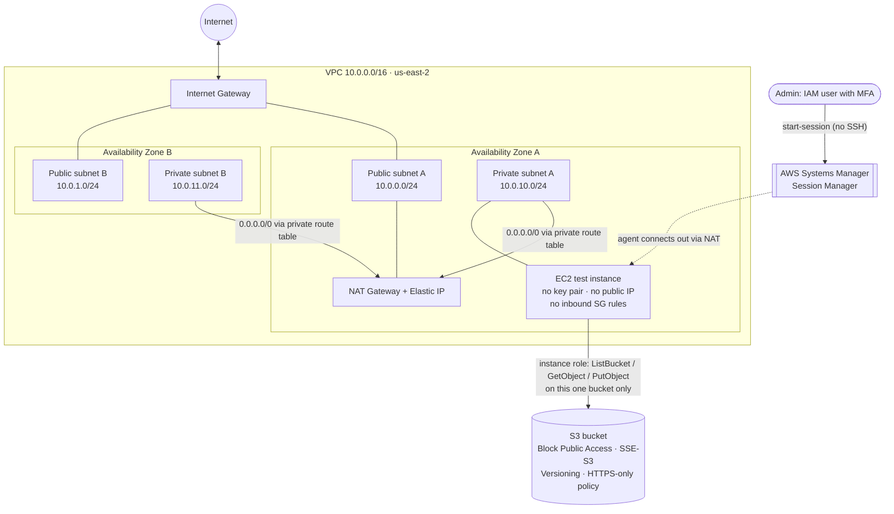
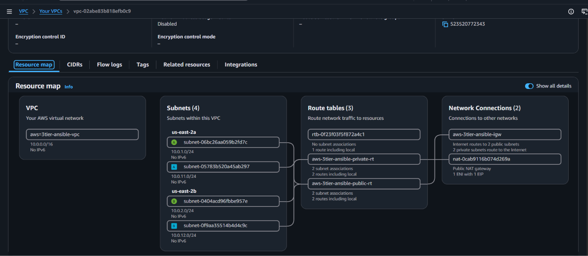

# AWS 3-Tier Lab: VPC, Least-Privilege IAM, and Ansible

**A multi-AZ AWS environment I'm building step by step with Bash, the AWS CLI, and (next) Ansible, with screenshots that show each security control working.**


---

## Architecture (current state: Milestones 1–2)



> Public subnets route `0.0.0.0/0` to the Internet Gateway. Private subnets route `0.0.0.0/0` to a single NAT Gateway in public subnet A. One NAT is a deliberate cost trade-off for a lab; production would use one per AZ.

## Tech stack

| Area | Tools / services |
|---|---|
| Infrastructure as code | Bash + AWS CLI (idempotent-ish scripts with a state file and teardown) |
| Networking | VPC, subnets in 2 AZs, Internet Gateway, NAT Gateway, Elastic IP, route tables |
| Security | IAM (MFA admin, scoped instance role), S3 Block Public Access, SSE-S3, bucket policy, Session Manager instead of SSH |
| Cost control | AWS Budgets alarm ($20/month, email alert at 80%), teardown script |
| Config management | Ansible (Milestone 3) |

## Milestone progress

| # | Milestone | Status | Evidence |
|---|---|---|---|
| M1 | 2-AZ VPC (public/private subnets, IGW, NAT, route tables) via Bash/AWS CLI, plus teardown script, budget alarm, IAM admin with MFA | ✅ Done | [`scripts/`](scripts), [`docs/vpc-resource-map.png`](docs/vpc-resource-map.png), [`docs/nat-gateway-available.png`](docs/nat-gateway-available.png) |
| M2 | S3 hardening + least-privilege EC2 role + private instance reached only through Session Manager | ✅ Done | [`policies/bucket-https-only.json`](policies/bucket-https-only.json), [`docs/m2-least-privilege-test.png`](docs/m2-least-privilege-test.png) |
| M3 | EC2 configured with Ansible + launch template | ⏳ Planned | |
| M4 | Application Load Balancer + Auto Scaling group | ⏳ Planned | |
| M5 | CloudWatch alarms → SNS notifications | ⏳ Planned | |
| M6 | Final write-up: architecture diagram, design decisions mapped to SAA-C03 domains, cost notes | ⏳ Planned | |

---

## Milestone 1: Multi-AZ network

| Piece | Detail |
|---|---|
| VPC | `10.0.0.0/16`, DNS support and DNS hostnames enabled |
| Public subnets | 2, one per AZ (`10.0.0.0/24`, `10.0.1.0/24`), auto-assign public IP |
| Private subnets | 2, one per AZ (`10.0.10.0/24`, `10.0.11.0/24`) |
| Internet Gateway + public route table | `0.0.0.0/0` → IGW, associated with both public subnets |
| NAT Gateway + private route table | single NAT Gateway (with Elastic IP) in public subnet A; `0.0.0.0/0` → NAT, associated with both private subnets |
| Tagging | Every resource tagged `Name` and `Project` (VPC also gets `Environment`) |

How the scripts behave:
- `01-create-vpc.sh` writes each resource ID to `state/vpc.env` **as soon as it is created**, so if a run fails partway it can still be torn down cleanly. An `ERR` trap reminds you to run teardown.
- `99-teardown.sh` deletes in dependency order (NAT → Elastic IP → route tables → IGW → subnets → VPC), waits for the NAT Gateway to finish deleting, and is safe to re-run.
- `00-budget-and-iam-checklist.sh` prints the one-time account checklist (root MFA, MFA admin user) and, if `BUDGET_EMAIL` is set, creates a $20/month cost budget that emails at 80%.



## Milestone 2: IAM least privilege, S3 hardening, SSM access

**What I built**
- S3 bucket with Block Public Access (all four settings), default SSE-S3 encryption, versioning, and a bucket policy that denies non-HTTPS requests ([`policies/bucket-https-only.json`](policies/bucket-https-only.json)).
- EC2 instance role `dj-3tier-ec2-role` with a scoped policy that allows only `s3:ListBucket`, `s3:GetObject`, and `s3:PutObject` on this one bucket, plus the AWS managed policy `AmazonSSMManagedInstanceCore`.
- Test instance in a **private subnet** with no key pair, no public IP, and no inbound security group rules. The only way in is SSM Session Manager.

> M2 resources were set up by hand, not by a script. Scripting them is on the list for M3.

**Verification**
- Instance registered in SSM as `Online`.
- From a Session Manager shell, uploading to and listing the project bucket succeeded.
- `aws s3 ls` (list all buckets) returned **AccessDenied**, which shows the role is limited to one bucket:


---

## Deploy and tear down

**Prerequisites:** AWS CLI v2, Bash, and an AWS CLI profile for an IAM admin identity with MFA (don't use root).

```bash
git clone https://github.com/Devdantech/aws-3tier-ansible.git
cd aws-3tier-ansible

export AWS_PROFILE=<your-profile>      # your own CLI profile
export AWS_REGION=us-east-2            # default region

# One-time account checklist + optional $20/month budget alarm
BUDGET_EMAIL=you@example.com ./scripts/00-budget-and-iam-checklist.sh

# Build the 2-AZ network (takes a few minutes while the NAT Gateway comes up)
./scripts/01-create-vpc.sh

# Tear it all down when you're finished. The NAT Gateway bills by the hour.
./scripts/99-teardown.sh
```

> ⚠️ **Cost:** NAT Gateway and Elastic IP charges keep running until you tear them down. Run `99-teardown.sh` after every session.
> The teardown script removes only the M1 network. Delete the M2 test instance first, and remove the bucket and role separately if you no longer need them.

## Repository layout

```
scripts/    Bash + AWS CLI build, teardown, and shared settings (lib.sh)
policies/   IAM / bucket policy JSON
docs/       Screenshots used as evidence
ansible/    Inventory and roles (Milestone 3)
state/      Local resource IDs written by the scripts (gitignored)
```

## What I learned

- **Build for failure, not just success.** Saving each resource ID as soon as it exists means a half-finished run can still be torn down, so nothing gets orphaned and keeps billing.
- **Deletion order matters.** A VPC won't delete while a NAT Gateway, IGW attachment, or subnets still depend on it. The teardown has to wait for the NAT to reach `deleted` before releasing its Elastic IP.
- **Least privilege is something you test.** Seeing `AccessDenied` on `s3:ListAllMyBuckets` while object upload/list on the project bucket still works proves the role's scope.
- **You don't need SSH.** With `AmazonSSMManagedInstanceCore` and a route out through the NAT, a private instance with no key pair and no inbound rules is still reachable through Session Manager.
- **Check region and profile first.** The CLI and console have to point at the same account and region (us-east-2), or resources look like they've disappeared.
- **Session Manager logs you in as `ssm-user`** in a directory you can't write to. Run `cd ~` before creating files.

## Roadmap

- **M3:** Launch template + Ansible playbooks (web server role, CloudWatch agent) for private instances; script the M2 resources
- **M4:** Application Load Balancer in the public subnets, Auto Scaling group in the private subnets
- **M5:** CloudWatch alarms → SNS email notifications
- **M6:** Final architecture diagram, design decisions mapped to SAA-C03 domains, cost notes

---

*Built by Daniel Thompson, working toward cloud/DevOps. AWS Certified Cloud Practitioner, currently studying for Solutions Architect – Associate (SAA-C03).*
